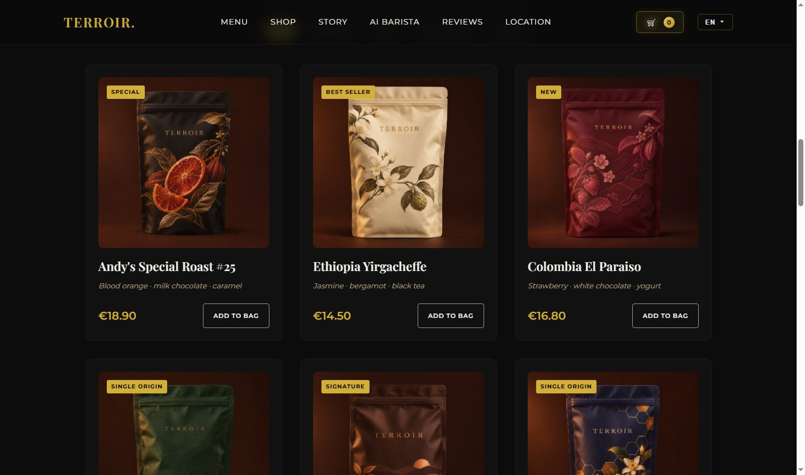

# Terroir Specialty Coffee

   

A storefront concept for a specialty coffee shop. I wanted the site to feel like opening a café menu and browsing the shelves in the same visit.

[Open the live demo](https://terroir-coffee-portfolio.vercel.app/)

Explore the café menu, filter the bean catalog, open a product card or try the taste quiz. The demo also includes a shopping bag and a local catalog editor. The interface is available in English, Spanish, Ukrainian and German.

[View a screenshot of the storefront](docs/desktop.jpg)

## Run locally

Serve this directory with any static HTTP server. For example:

```sh
python -m http.server 5173
```

Open [localhost:5173](http://localhost:5173/) in your browser. The site uses HTML, CSS and vanilla JavaScript, with an OpenStreetMap view of central Madrid.

## About the demo

The shop details, reviews and prices illustrate the design. The bag does not place orders or accept payments. The taste quiz is rule-based, and the catalog editor saves changes only in the current browser.

The product package images and homepage photograph were generated for this project. The cover above is a screenshot of the catalog. [Original coffee artwork](docs/terroir-cover.jpg).

## Optional AI barista

The Coffee Finder works on the static site. The AI barista also supports comparisons and brewing questions through the Vercel function at `/api/barista`.

1. Create a Gemini API key for a dedicated project in Google AI Studio. Check the text model's quota and pricing.
2. In Vercel, add `GEMINI_API_KEY` as a sensitive Preview environment variable. Set `BARISTA_ENABLED=true` for Preview and redeploy. Optionally set `GEMINI_MODEL` to override the default `gemini-3.1-flash-lite`.
3. Test one question in each mode on Preview. Before enabling production, add a WAF rate limit to POST requests on `/api/barista` and verify the quota on the Gemini project. Then configure the production variables and redeploy.

The app sends the question, instruction and public catalog data to Gemini. It does not store a chat history or use a database. If the AI barista is disabled or unavailable, the original quiz remains usable.
