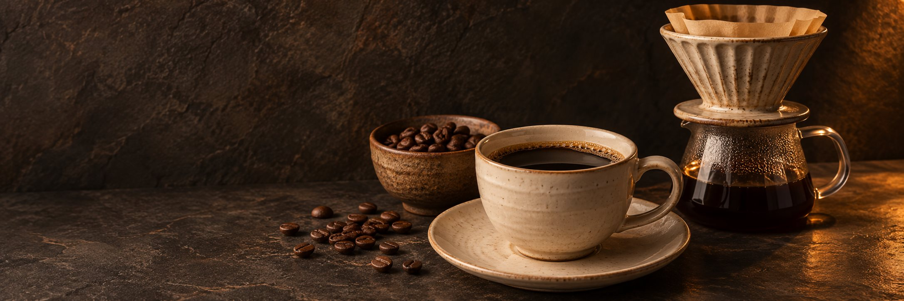

# Terroir Coffee

A storefront concept for a specialty coffee shop. I wanted the site to feel like opening a café menu and browsing the shelves in the same visit.

Explore the café menu, filter the bean catalog, open a product card or try the taste quiz. The demo also includes a shopping bag and a local catalog editor. The interface is available in English, Spanish and Ukrainian.

[View a screenshot of the storefront](docs/desktop.jpg)

## Run locally

Serve this directory with any static HTTP server. For example:

```sh
python -m http.server 5173
```

Open [localhost:5173](http://localhost:5173/) in your browser. The site uses HTML, CSS and vanilla JavaScript, with Leaflet for the map.

## About the demo

The shop details, reviews and prices illustrate the design. The bag does not place orders or accept payments. The taste quiz is rule-based, and the catalog editor saves changes only in the current browser.

The README cover was generated for this project.
